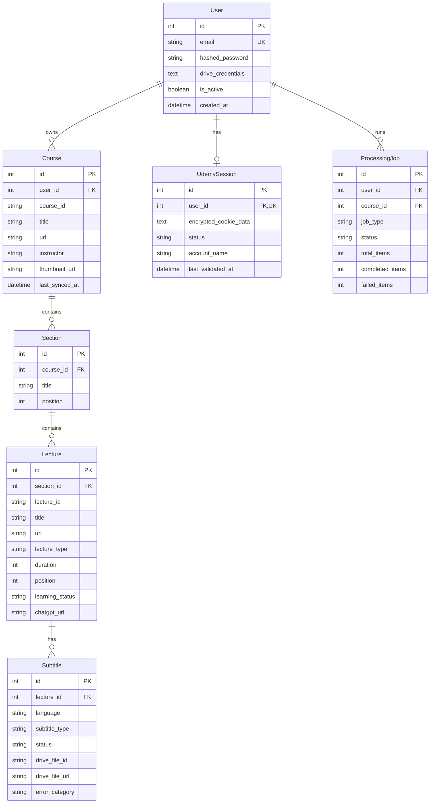

# Udemy Subtitle Manager

A production-quality, local-first full-stack web application designed for personal learning and private management of Udemy course subtitles. Built with **FastAPI (Python 3.11+, SQLAlchemy 2.0, Alembic)**, **Next.js 14 (App Router, TypeScript, Tailwind CSS)**, **PostgreSQL / SQLite**, and **Google Drive OAuth 2.0**.

---

## 🚀 Key Features

- **Architectural Separation:** Modern Next.js TypeScript frontend and asynchronous FastAPI backend.
- **Strict Per-User Scoping:** JWT-based user authentication, bcrypt password hashing, and strict database query scoping preventing any cross-user data leakage.
- **Secure Netscape Cookie Management:**
  - Securely import and parse Netscape-format `cookies.txt` files.
  - Validates syntax and Udemy domains (`.udemy.com`, `www.udemy.com`).
  - Encrypts session cookies at rest using Fernet symmetric cryptography derived from server `SECRET_KEY`.
  - Live **Test Connection** action checking real Udemy authenticated status (`CONNECTED`, `EXPIRED_SESSION`, `INVALID_COOKIES`, `ACCESS_DENIED`, `DISCONNECTED`).
  - Never logs or exposes raw cookies in frontend responses, log files, or database dumps.
- **Curriculum Import & Hierarchy Preservation:**
  - Imports Udemy courses via landing or learning URLs (`https://www.udemy.com/course/<slug>/`).
  - Preserves exact section and lecture positions, titles, types (video, article), and durations.
  - Per-user course duplicate prevention (`UNIQUE(user_id, course_id)`).
  - Re-synchronization preserves all user-entered data (learning statuses, ChatGPT links, uploaded subtitle references).
- **Intelligent Subtitle Processing:**
  - Priority 1: Manually authored English captions (`en`, `en_US`, etc.).
  - Priority 2: Automatically generated English captions.
  - Priority 3: User-selected custom subtitle language.
  - Integrity guarantee: Never falsely labels auto-generated captions as manual, and never fabricates caption text.
  - WebVTT (`.vtt`) format preservation and SubRip (`.srt`) conversion support.
- **Direct & Manual Fallback Workflow:**
  - Direct retrieval of captions for enrolled courses via authenticated session.
  - Manual `.vtt` / `.srt` file upload fallback for any lecture where platform access is restricted or expired.
- **Verified Google Drive Sync:**
  - Minimal scope OAuth 2.0 integration (`https://www.googleapis.com/auth/drive.file`).
  - Automatically creates organized folder structures:
    ```
    Udemy Subtitles/
      Course Title/
        Section 01 - Introduction/
          001 - Welcome to the Course.vtt
          002 - Overview.vtt
    ```
  - **Conditional Cleanup:** Deletes temporary local subtitle files *strictly only after confirmed successful upload*. If upload fails, local files are safely preserved.
  - Deleting local course records never deletes Google Drive files.
- **ChatGPT Summary Link Management:**
  - Associate ChatGPT conversation URLs (`chatgpt.com` / `chat.openai.com`) with each lecture.
  - Validate and open conversation links in new tabs.
  - Preserved across curriculum re-imports.
- **Background Jobs & Concurrency:**
  - Asynchronous background worker threads for curriculum imports and batch subtitle processing.
  - Persistent job tracking (`ProcessingJob`) surviving page refreshes.
  - Cooperative job cancellation and resumption skipping already completed items.

---

## 🛠 Technology Stack

- **Frontend:** Next.js 14 (App Router), TypeScript, Tailwind CSS, Lucide React
- **Backend:** Python 3.11+, FastAPI, SQLAlchemy 2.0, Pydantic v2, Alembic
- **Database:** PostgreSQL (with SQLite for local development and isolated automated tests)
- **Security:** Passlib (Bcrypt), PyJWT, Cryptography (Fernet)
- **Subtitle Processing:** WebVTT-py, yt-dlp, HTTPX
- **Integrations:** Google Drive API v3, Google OAuth 2.0
- **Containerization:** Docker, Docker Compose

---

## 📐 Architecture & Entity Model



---

## 📋 Prerequisites

- **Python 3.11+**
- **Node.js 18+** & **npm**
- **Docker & Docker Compose** (optional for containerized deployment)

---

## ⚡ Quick Start: Docker Compose

1. **Clone or enter the project directory:**
   ```powershell
   cd "c:\Users\toanv\OneDrive\Desktop\Udemy subtitle manager"
   ```

2. **Create the environment file:**
   ```powershell
   Copy-Item .env.example .env
   ```

3. **Start services:**
   ```powershell
   docker compose up --build
   ```

4. **Access the application:**
   - **Frontend:** [http://localhost:3000](http://localhost:3000)
   - **Backend API Docs (Swagger):** [http://localhost:8000/docs](http://localhost:8000/docs)
   - **API Health Check:** [http://localhost:8000/health](http://localhost:8000/health)

---

## 💻 Direct Local Development Setup (Windows 11 PowerShell)

### 1. Backend Setup

1. **Navigate to the backend directory and activate the virtual environment:**
   ```powershell
   cd backend
   .\venv\Scripts\Activate.ps1
   ```

2. **Install Python dependencies:**
   ```powershell
   pip install -r requirements.txt
   ```

3. **Configure Environment Variables:**
   Create `.env` in the root or `backend/` directory based on `.env.example`:
   ```env
   DATABASE_URL=sqlite:///./udemy_subtitles.db
   SECRET_KEY=<random value with at least 32 characters>
   FRONTEND_URL=http://localhost:3000
   GOOGLE_CLIENT_ID=your-google-client-id.apps.googleusercontent.com
   GOOGLE_CLIENT_SECRET=your-google-client-secret
   GOOGLE_REDIRECT_URI=http://localhost:8000/api/drive/callback
   GOOGLE_DRIVE_FOLDER_NAME=Udemy Subtitles
   ```
   Generate a value with `python -c "import secrets; print(secrets.token_urlsafe(48))"` and replace the `SECRET_KEY` placeholder. The server refuses to start when the key is missing or shorter than 32 characters.

4. **Run Alembic database migrations:**
   ```powershell
   alembic upgrade head
   ```

5. **Start the FastAPI server:**
   ```powershell
   uvicorn app.main:app --reload --host 0.0.0.0 --port 8000
   ```

---

### 2. Frontend Setup

1. **Open a new PowerShell terminal and enter the frontend folder:**
   ```powershell
   cd frontend
   ```

2. **Install Node.js dependencies:**
   ```powershell
   npm install
   ```

3. **Start the Next.js development server:**
   ```powershell
   npm run dev
   ```

4. **Open in browser:**
   Navigate to [http://localhost:3000](http://localhost:3000).

---

## 🔑 Google Drive OAuth 2.0 Setup Guide

To upload subtitle files to Google Drive in organized course folders:

1. Open the [Google Cloud Console](https://console.cloud.google.com/).
2. Create a new project (e.g. `Udemy Subtitle Manager`).
3. Under **APIs & Services > Library**, search for **Google Drive API** and click **Enable**.
4. Under **APIs & Services > OAuth consent screen**:
   - Choose **External**.
   - Fill in the required application name and contact email.
   - Under Scopes, add `.../auth/drive.file`.
   - Add your Google account under **Test Users**.
5. Under **APIs & Services > Credentials**:
   - Click **Create Credentials > OAuth client ID**.
   - Select **Web application**.
   - Under **Authorized redirect URIs**, add:
     `http://localhost:8000/api/drive/callback`
6. Add the credentials to your `.env` file:
   ```env
   GOOGLE_CLIENT_ID=xxxxxx.apps.googleusercontent.com
   GOOGLE_CLIENT_SECRET=xxxxxx
   GOOGLE_REDIRECT_URI=http://localhost:8000/api/drive/callback
   ```
7. In the dashboard header, click **Drive** to connect your account.

---

## 🍪 Udemy Session Setup & Cookie Management

1. Log into your Udemy account in your web browser.
2. Export your cookies in Netscape format using a trusted local extension (such as *Get cookies.txt LOCALLY* for Chrome/Edge/Firefox).
3. On the dashboard, click the **Udemy** badge in the header.
4. Upload your `cookies.txt` file or paste its contents into the text area.
5. Click **Save & Verify Cookies**.
6. The server will validate the format, encrypt the cookies with Fernet, and perform a live validation against Udemy's authenticated API.
7. Click **Test Connection** at any time to verify your session status.

---

## ⚖️ Legal & Platform Constraints

- **Personal Learning Use Only:** This application is strictly intended for personal learning and archiving subtitles for courses the user owns or is enrolled in.
- **No Video Downloading:** This tool deliberately manages subtitles only and does not download or distribute course videos.
- **No DRM or Paywall Bypassing:** The tool does not circumvent Digital Rights Management, CAPTCHAs, or paywalls.
- **Manual Upload Fallback:** If a course relies on protected media delivery or restricted endpoints that cannot be directly extracted, use the built-in **Manual Upload** button on any lecture to upload `.vtt` or `.srt` files and automatically sync them to Google Drive.

---

## 🧪 Verification & Testing

### Backend Automated Test Suite

Run the full pytest suite (covering authentication, user isolation, Netscape cookie validation, URL normalization, curriculum parsing, subtitle selection preference, conditional Drive file deletion, job cancellation, and ChatGPT link management):

```powershell
cd backend
.\venv\Scripts\python -m pytest -v tests
```

### Frontend Typecheck & Production Build

Verify TypeScript compile integrity and static production build:

```powershell
cd frontend
npm run typecheck
npm run build
```
